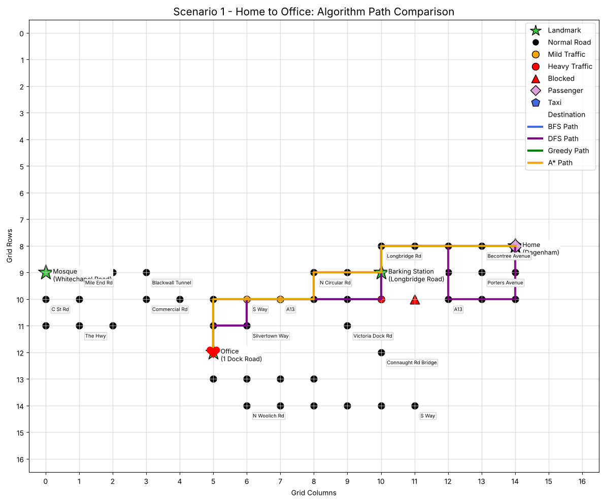
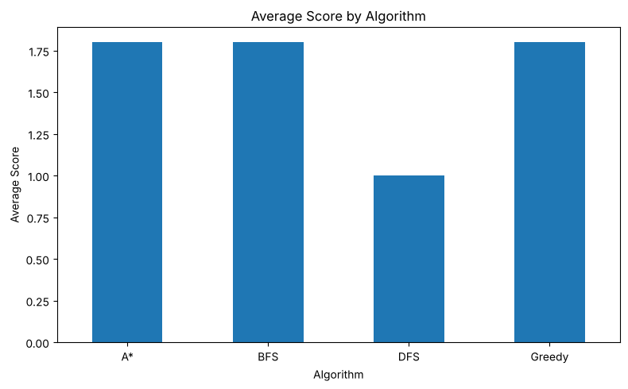

# London Taxi Search Agent

A rational **taxi agent** that drives through a grid model of East London to pick up a passenger and drop them off,
comparing four search strategies: **BFS, DFS, Greedy Best-First and A\***. Roads have traffic costs and some are
blocked, so the shortest route is not always the cheapest.

**Module:** CMPN206 Artificial Intelligence, Year 2 (Spring 2026), University of Roehampton.  
**Grade: 92% (Upper First).** Marker: *"Excellent demo. Answered all the hard questions."*



## How it works
| Part | Design |
|---|---|
| **Environment** | 17×17 grid of real East London roads and landmarks; cells are normal, mild traffic, heavy traffic or blocked |
| **Percepts** | taxi position, passenger location, destination, valid neighbouring roads |
| **Actions** | move N/S/E/W, pick up, drop off |
| **Performance measure** | +5 pickup, +20 drop-off, −1 per move, −20 if the trip fails |
| **Search** | BFS and DFS (uninformed); Greedy Best-First (Manhattan-distance heuristic only); A\* (traffic-weighted path cost: normal 1, mild 3, heavy 6, plus the Manhattan heuristic) |
| **Evaluation** | 5 scenarios × 4 algorithms: success, steps, score, nodes explored, path cost, path length |

## Results (from the notebook)
| Scenario | Algorithm | Success | Steps | Score | Nodes explored | Path cost |
|---|---|---|---|---|---|---|
| 1 Home → Office | BFS | ✔ | 13 | 12 | 26 | 22 |
| | DFS | ✔ | 17 | 8 | 21 | 26 |
| | Greedy | ✔ | 13 | 12 | **15** | **17** |
| | **A\*** | ✔ | 13 | 12 | 24 | **17** |
| 2 Office → Mosque | all four | ✔ | 8 | 17 | 10–22 | 8 |
| 4 Barking → Home | all four | ✔ | 5 | 20 | 7–18 | 5 |
| 3 and 5 | all four | ✘ | – | −20 | 24–30 | no route |

- **A\*** finds the cheapest route through traffic; **BFS** finds the fewest steps but drives through traffic (cost 22 vs 17)
- **DFS** takes the longest path; **Greedy** expands the fewest nodes but is not guaranteed optimal
- In scenarios 3 and 5 the blocked roads leave no route, and every algorithm correctly reports failure



## Run it
```bash
pip install -r requirements.txt
jupyter notebook london_taxi_search_agent.ipynb   # then Kernel → Restart & Run All
```

## Files
- [`london_taxi_search_agent.ipynb`](london_taxi_search_agent.ipynb): environment, search algorithms, scoring, experiments and plots
- [`docs/report.pdf`](docs/report.pdf): coursework report (PEAS, design, evaluation, explainability, reflection)

## Revisions after submission
- **Run All failed in the submitted notebook:** the "test grid" plot cell ran before `plot_environment()` was defined (the notebook had been run out of order). The cell was moved below the function, and the notebook now runs top to bottom with identical results.
- Removed a trailing empty cell; re-executed so execution counts are sequential.
- The home landmark label was changed to an area name for privacy.
